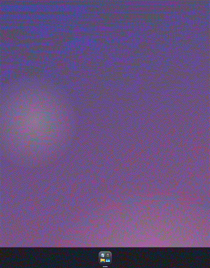
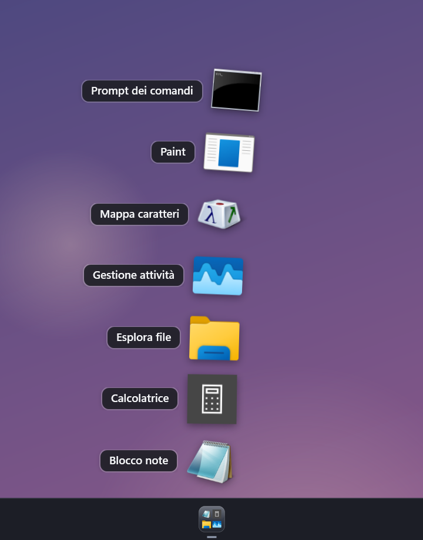
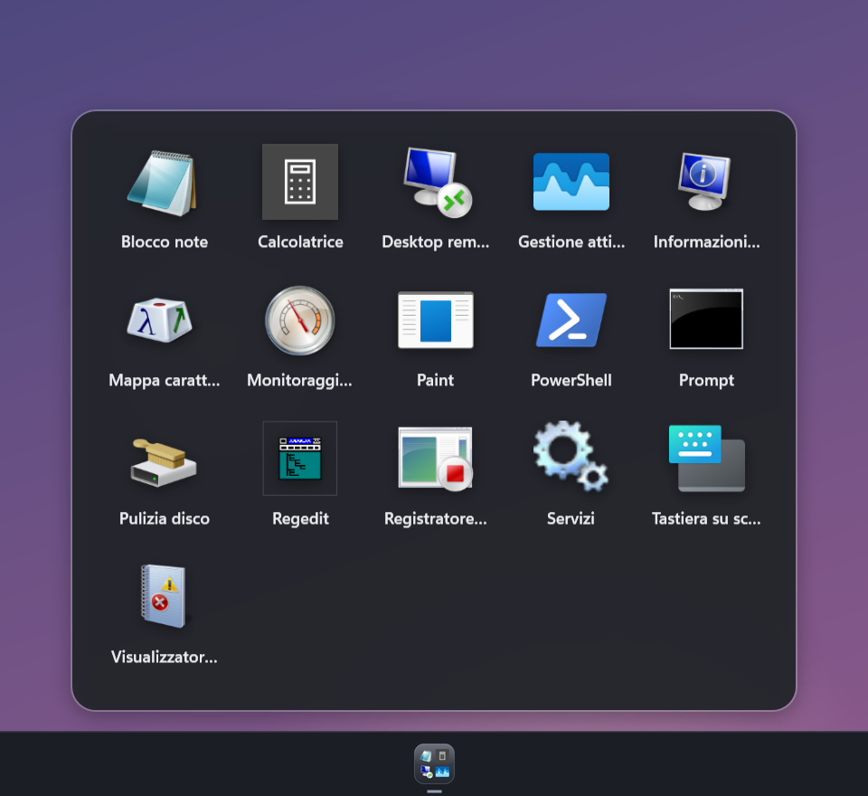
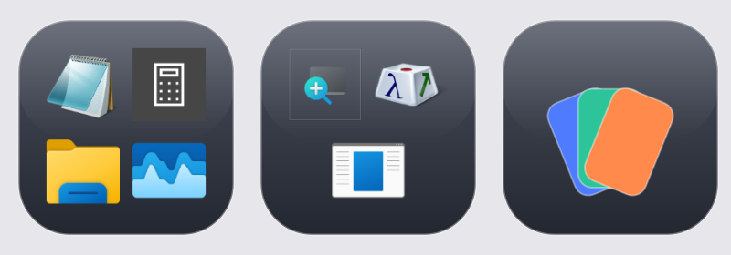
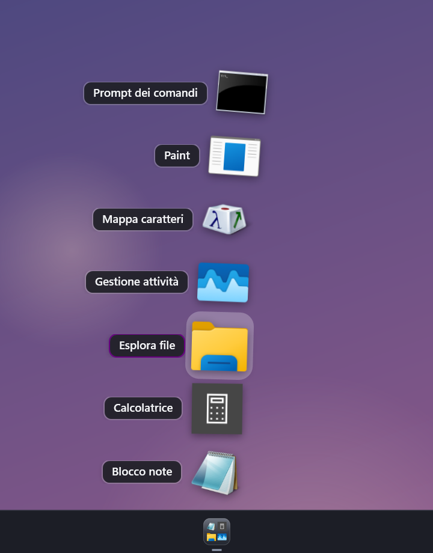

<p align="center">
  
</p>

<h1 align="center">FanStack</h1>

<p align="center">
  <b>Cartelle di app che si aprono a ventaglio dalla taskbar di Windows</b><br>
  Come le Stack del Dock di macOS, ma sulla taskbar normale di Windows 10 e 11.
</p>

<p align="center">
  <a href="../../releases/latest"><b>⬇ Scarica FanStack.exe</b></a> ·
  <a href="#crea-il-primo-stack-in-2-minuti">Guida rapida</a> ·
  <a href="#english">English</a>
</p>

---

Fissi sulla taskbar un'icona per ogni gruppo di app (Ufficio, Giochi, Grafica...). Clic sull'icona: le app escono a ventaglio sopra la taskbar. Clic su un'app: parte, e il ventaglio sparisce.

- **Niente dock nuovo**: usa la taskbar che hai già.
- **Uno stack è una cartella normale** con dentro i collegamenti: per aggiungere o togliere un'app basta trascinarla.
- **Leggero**: un solo `.exe` da 600 KB, nessun servizio in background, niente installazione, niente amministratore.
- **Niente rete, niente telemetria**, nessun aggiornamento automatico.

| Ventaglio | Più di 10 app: griglia |
|---|---|
|  |  |

L'icona sulla taskbar mostra l'anteprima delle prime 4 app ed è generata dal programma (si aggiorna da sola):



## Requisiti

- Windows 10 o Windows 11 (x64)
- [.NET 8 Desktop Runtime](https://dotnet.microsoft.com/download/dotnet/8.0) (se manca, Windows lo propone al primo avvio)

## Crea il primo stack in 2 minuti

1. **Scarica** `FanStack.exe` dalla pagina [Releases](../../releases/latest) e mettilo in una cartella dove resterà, per esempio `C:\Users\<tuo nome>\FanStack\`.
   Non spostarlo dopo: i collegamenti puntano lì (se lo sposti, ripeti il punto 2).
2. **Doppio clic** su `FanStack.exe`: si apre una piccola finestra. Scrivi un nome (es. `Ufficio`) e premi **Crea**.
3. Si apre la cartella `%UserProfile%\FanStacks\Ufficio`. **Trascinaci i collegamenti** delle app che vuoi (dal menu Start puoi trascinare direttamente un'app sulla cartella).
   Per scegliere l'ordine metti un numero davanti al nome: `01 - Word`, `02 - Excel` (il numero non si vede nel ventaglio).
4. Sul Desktop è comparso il collegamento **Ufficio**. **Tasto destro → Mostra altre opzioni → Aggiungi alla barra delle applicazioni.**
   Questo passo va fatto a mano: Windows non permette ai programmi di fissare icone da soli.
5. **Clicca l'icona sulla taskbar.** Fatto.

Ripeti per tutti gli stack che vuoi: ognuno resta un'icona separata sulla taskbar. Le icone fissate restano anche dopo il riavvio del PC.

## Uso

| Cosa | Come |
|---|---|
| Aprire il ventaglio | clic sull'icona dello stack nella taskbar |
| Avviare un'app | clic sull'app, oppure frecce + Invio |
| Chiudere | Esc, clic fuori, o di nuovo clic sull'icona |
| Aggiungere/togliere app | metti o togli collegamenti nella cartella dello stack |
| Collegamenti `.url` (es. giochi Steam) | funzionano come i `.lnk` |

Navigazione da tastiera:



## Riga di comando

```
FanStack.exe                         finestra di aiuto (con creazione rapida)
FanStack.exe --create "Nome"         crea cartella, icona e collegamento sul Desktop
FanStack.exe --stack "C:\cartella"   apre il ventaglio per una cartella qualsiasi
FanStack.exe --refresh-icons         rigenera le icone di tutti gli stack
```

`--quiet` (con `--create` e `--refresh-icons`) non mostra finestre.

## Dove finiscono i file

| Cosa | Dove |
|---|---|
| Stack (cartelle con collegamenti) | `%UserProfile%\FanStacks\<Nome>\` |
| Icone degli stack | `%AppData%\FanStack\icons\` |
| Cache delle icone delle app | `%AppData%\FanStack\cache\` |
| Log | `%AppData%\FanStack\log.txt` (ruota a 512 KB) |

Per disinstallare: togli le icone dalla taskbar e cancella `FanStack.exe`, la cartella `%AppData%\FanStack` e, se vuoi, `%UserProfile%\FanStacks`.

## Problemi comuni

- **L'icona sulla taskbar non mostra le app nuove**: si aggiorna quando chiudi il ventaglio. Se Windows tiene la vecchia, lancia `FanStack.exe --refresh-icons` (a volte serve riavviare Esplora risorse).
- **Due stack finiscono nella stessa icona**: succede solo con collegamenti non creati da FanStack. Ricrea lo stack con `--create`.
- **"La cartella non esiste"**: hai rinominato o spostato la cartella dello stack. Ricrealo con `--create`.
- **Ho spostato `FanStack.exe` e le icone non vanno più**: lancialo dalla nuova posizione, ricrea gli stack con lo stesso nome (le cartelle con le app restano) e fissa di nuovo i collegamenti.

## Come funziona

- Ogni collegamento creato ha un **AppUserModelID** unico (`FanStack.Stack.<Nome>.<hash>`), e il processo imposta lo stesso ID all'avvio: per questo Windows tiene gli stack come icone separate anche se puntano tutti allo stesso `.exe`.
- Al clic parte `FanStack.exe --stack "cartella"`: legge la posizione del cursore e della taskbar (anche su secondo monitor e con DPI diversi), calcola il ventaglio, lo mostra e termina appena hai scelto.
- Le icone delle app arrivano dalla shell di Windows in alta risoluzione e restano in cache su disco.
- Tutta la grafica (ventaglio, pillole, icone degli stack) è generata in codice. Nessun asset Apple o di terzi.

Stato delle prove: provato su Windows 11 con taskbar in basso, griglia, tastiera, collegamenti rotti, due stack fissati. Taskbar in alto/sinistra/destra e secondo monitor sono coperti dai test automatici e da una simulazione, ma non ancora da prove su una taskbar vera spostata: segnalazioni benvenute.

## Compilare dal codice

Serve il [.NET 8 SDK](https://dotnet.microsoft.com/download/dotnet/8.0).

```
dotnet build
dotnet test
dotnet publish src/FanStack.App -c Release -r win-x64 --self-contained false -p:PublishSingleFile=true -p:PublishReadyToRun=true -p:DebugType=None -o dist
```

| Cartella | Contenuto |
|---|---|
| `src/FanStack.Core` | logica pura e testata: lettura stack, geometria del ventaglio, nomi, formato `.ico` |
| `src/FanStack.App` | WPF + interop WinAPI/COM (collegamenti, icone, finestra) |
| `tests/FanStack.Core.Tests` | 171 test xUnit |
| `docs/DECISIONI.md` | le scelte di progetto e perché |

Per provare gli altri bordi della taskbar senza spostarla: `set FANSTACK_SIMULATE_EDGE=Left` (o `Top`, `Right`) prima di lanciare `--stack`.

## English

**FanStack** pins app folders to the regular Windows 10/11 taskbar. Click a pinned stack and its apps fan out above the taskbar, macOS Dock Stacks style; click an app to launch it. A stack is just a folder of shortcuts. Download `FanStack.exe` from [Releases](../../releases/latest), run it, type a name and press **Crea** (Create), drop shortcuts into the folder that opens, then right-click the new Desktop shortcut → *Show more options* → *Pin to taskbar*. Requires the .NET 8 Desktop Runtime. The UI is in Italian.

## Licenza

[MIT](LICENSE)
